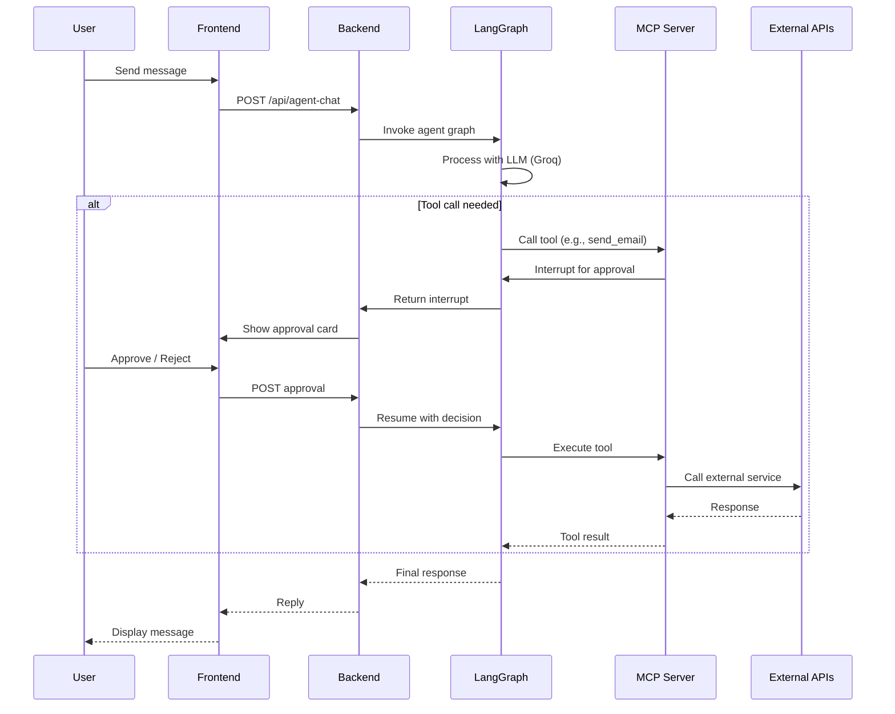

# 🤖 AutoMate AI

**AI-powered personal automation platform** — Create custom AI agents that can send emails, schedule calendar events, publish to Instagram, analyze images, and more — all through natural conversation.


---

## ✨ Features

### 🧠 Custom AI Agents
- Create personalized AI agents with custom instructions, names, and descriptions
- Choose between multiple LLM models (GPT-OSS 120B / 20B via Groq)
- Configure temperature and tool access per agent
- Each agent maintains its own conversation thread with memory

### 📧 Gmail Integration
- **Send Emails** — Compose and send emails through natural language commands
- **Read Emails** — Search and read inbox emails using Gmail search syntax
- **Smart Approval** — Every outgoing email requires explicit user approval before sending

### 📅 Google Calendar
- **Create Events** — Schedule meetings and events with natural language ("Schedule a meeting tomorrow at 3 PM")
- **List Events** — View upcoming calendar events for any date range
- **Smart Date Resolution** — Automatically resolves "today", "tomorrow", weekday references

### 📸 Instagram Publishing
- **Image Upload** — Upload images via Cloudinary CDN
- **AI-Generated Captions** — Automatically generates captions and hashtags using AI
- **Post Preview** — Review image, caption, and hashtags before publishing
- **Approval Workflow** — Approve or reject posts before they go live

### 🖼️ Image Analysis
- **Vision AI** — Analyze uploaded images using vision models
- **Image Q&A** — Ask questions about image contents

### 💳 Credits & Payments
- **Credit System** — Users start with 100 free credits
- **Razorpay Integration** — Purchase additional credits with multiple pricing tiers
- **Usage Tracking** — Automatic credit deduction per AI interaction

### 🔐 Authentication & Security
- **Firebase Auth** — Google Sign-In via Firebase Authentication
- **JWT Sessions** — Secure HTTP-only cookie-based sessions
- **OAuth2 Integrations** — Encrypted token storage for connected services
- **AES-256-GCM Encryption** — All integration tokens encrypted at rest
- **MCP Auth** — Signed JWT tokens for backend ↔ MCP server communication

---

## 🏗️ Architecture

```
┌─────────────────────────────────────────────────────────┐
│                    Frontend (React)                      │
│  React 19 · Vite · Tailwind CSS v4 · shadcn/ui · Redux │
└──────────────────────┬──────────────────────────────────┘
                       │ REST API
┌──────────────────────▼──────────────────────────────────┐
│                 Backend (Express.js)                     │
│  Firebase Admin · JWT · Mongoose · Razorpay · OAuth2    │
└──────────────────────┬──────────────────────────────────┘
                       │ MCP Protocol (stdio)
┌──────────────────────▼──────────────────────────────────┐
│               MCP Server (Tool Server)                   │
│  Gmail API · Calendar API · Instagram Graph API          │
│  Gemini Vision · Cloudinary                              │
└──────────────────────┬──────────────────────────────────┘
                       │
┌──────────────────────▼──────────────────────────────────┐
│              LangGraph (Agent Runtime)                    │
│  StateGraph · Tool Nodes · Human-in-the-Loop Interrupts │
│  MongoDB Checkpointer · Groq LLM                        │
└─────────────────────────────────────────────────────────┘
```

---

## 🛠️ Tech Stack

### Frontend
| Technology | Purpose |
|---|---|
| **React 19** | UI framework |
| **Vite 8** | Build tool & dev server |
| **Tailwind CSS v4** | Utility-first styling |
| **shadcn/ui** | Pre-built UI components |
| **Redux Toolkit** | Global state management |
| **React Router v7** | Client-side routing |
| **Firebase Auth** | Google Sign-In |
| **Axios** | HTTP client |
| **Lucide React** | Icon library |
| **Sonner** | Toast notifications |

### Backend
| Technology | Purpose |
|---|---|
| **Express 5** | REST API server |
| **MongoDB + Mongoose** | Database & ODM |
| **LangGraph** | Agentic AI runtime with state graphs |
| **LangChain** | LLM tools & chain orchestration |
| **Groq** | LLM inference provider |
| **MCP (Model Context Protocol)** | Standardized tool server protocol |
| **Firebase Admin** | Server-side auth verification |
| **Google APIs** | Gmail, Calendar, OAuth2 |
| **Razorpay** | Payment processing |
| **Zod v4** | Schema validation |
| **Cloudinary** | Image CDN & upload |
| **Gemini API** | Vision / image analysis |

---

## 📁 Project Structure

```
automate-ai/
├── backend/
│   ├── config/
│   │   ├── db.js                    # MongoDB connection
│   │   ├── firebase.js              # Firebase Admin SDK setup
│   │   ├── googleOAuth.js           # Google OAuth2 client
│   │   ├── langgraph-checkpointer.js # LangGraph MongoDB checkpointer
│   │   └── razorpay.js              # Razorpay instance
│   ├── controllers/
│   │   ├── agent.controller.js      # CRUD operations for AI agents
│   │   ├── agentChat.controller.js  # Agent conversation handler
│   │   ├── auth.controller.js       # Login, logout, session management
│   │   ├── chat.controller.js       # General chat controller
│   │   ├── integration.controller.js # OAuth connect/disconnect
│   │   └── payment.controller.js    # Razorpay order & verification
│   ├── mcp/
│   │   ├── server.js                # MCP tool server (Gmail, Calendar, Instagram)
│   │   ├── client.js                # MCP client connector
│   │   ├── langgraph-mcp.js         # LangGraph ↔ MCP adapter
│   │   └── tools/                   # Custom MCP tools
│   ├── middleware/
│   │   └── protect.js               # JWT auth middleware
│   ├── models/
│   │   ├── agent.model.js           # Agent schema
│   │   ├── integration.model.js     # OAuth integration schema
│   │   ├── payment.model.js         # Payment/order schema
│   │   └── user.model.js            # User schema
│   ├── routes/                      # Express route definitions
│   ├── services/
│   │   ├── agentGraph.service.js    # LangGraph agent with tool binding
│   │   └── chatGraph.service.js     # Chat service with LangGraph
│   ├── utils/
│   │   ├── deductCredits.js         # Credit deduction logic
│   │   └── encrypt.js               # AES-256-GCM encrypt/decrypt
│   ├── index.js                     # Express server entry point
│   └── package.json
│
├── frontend/
│   ├── src/
│   │   ├── components/
│   │   │   ├── ui/                  # shadcn/ui components
│   │   │   └── login-form.jsx       # Login form component
│   │   ├── features/
│   │   │   ├── agents/agentApi.js   # Agent API calls
│   │   │   ├── auth.js              # Auth API calls
│   │   │   └── chat.js              # Chat & approval API calls
│   │   ├── hooks/
│   │   │   └── useFetchMe.jsx       # Auto-fetch current user hook
│   │   ├── pages/
│   │   │   ├── Home.jsx             # Main chat interface
│   │   │   ├── Agents.jsx           # Agent management page
│   │   │   ├── CreateAgent.jsx      # Agent creation form
│   │   │   ├── Integration.jsx      # Service integrations page
│   │   │   ├── Login.jsx            # Login page
│   │   │   └── Pricing.jsx          # Credits & pricing page
│   │   ├── redux/
│   │   │   ├── store.js             # Redux store config
│   │   │   └── userSlice.js         # User state slice
│   │   ├── App.jsx                  # Route definitions
│   │   └── main.jsx                 # App entry point
│   └── package.json
│
└── .gitignore
```

---

## 🚀 Getting Started

### Prerequisites

- **Node.js** v18+
- **MongoDB** (local or Atlas)
- **Firebase** project with Authentication enabled
- **Google Cloud** project with Gmail & Calendar APIs
- **Groq** API key
- **Razorpay** account (for payments)
- **Cloudinary** account (for image uploads)

### 1. Clone the Repository

```bash
git clone https://github.com/whosatyamraj/Automate-AI.git
cd Automate-AI
```

### 2. Backend Setup

```bash
cd backend
npm install
```

Create a `backend/.env` file:

```env
PORT=8000
MONGODB_URI=your_mongodb_connection_string
MONGODB_DB_NAME=automate_ai
CLIENT_URL=http://localhost:5173

# Auth
JWT_SECRET=your_jwt_secret

# Firebase Admin
# Place your serviceAccountKey.json in backend/

# Google OAuth
GOOGLE_CLIENT_ID=your_google_client_id
GOOGLE_CLIENT_SECRET=your_google_client_secret
GOOGLE_REDIRECT_URI=http://localhost:8000/api/integrations/google/callback

# Groq (LLM)
GROQ_API_KEY=your_groq_api_key

# MCP Server Auth
AUTOMATE_MCP_SECRET=your_64_char_hex_secret

# Razorpay
RAZORPAY_KEY_ID=your_razorpay_key_id
RAZORPAY_KEY_SECRET=your_razorpay_key_secret

# Encryption
ENCRYPTION_KEY=your_64_char_hex_encryption_key

# Instagram
INSTAGRAM_APP_ID=your_instagram_app_id
INSTAGRAM_APP_SECRET=your_instagram_app_secret
INSTAGRAM_REDIRECT_URI=http://localhost:8000/api/integrations/instagram/callback

# Gemini (Vision)
GEMINI_API_KEY=your_gemini_api_key
```

Start the backend:

```bash
npm run dev
```

### 3. Frontend Setup

```bash
cd frontend
npm install
```

Create a `frontend/.env` file:

```env
VITE_FIREBASE_API_KEY=your_firebase_api_key
VITE_SERVER_URL=http://localhost:8000
VITE_CLOUDINARY_CLOUD_NAME=your_cloud_name
VITE_CLOUDINARY_UPLOAD_PRESET=your_upload_preset
```

Start the frontend:

```bash
npm run dev
```

The app will be running at **http://localhost:5173**

---

## 🔄 How It Works

### Agent Conversation Flow



### Human-in-the-Loop Approval

Every destructive action (sending emails, creating events, publishing to Instagram) goes through a **human-in-the-loop approval workflow**:

1. The AI agent decides to use a tool
2. LangGraph **interrupts** execution and returns the action details
3. The frontend shows an **approval card** with all details
4. The user can **Approve** or **Reject**
5. Only on approval does the action execute

---

## 📸 Screenshots

> _Coming soon_

---

## 🤝 Contributing

Contributions are welcome! Please feel free to submit a Pull Request.

1. Fork the repository
2. Create your feature branch (`git checkout -b feature/amazing-feature`)
3. Commit your changes (`git commit -m 'Add some amazing feature'`)
4. Push to the branch (`git push origin feature/amazing-feature`)
5. Open a Pull Request

---

## 📄 License

This project is open source and available under the [MIT License](LICENSE).

---

## 👨‍💻 Author

**Satyam Raj**  
GitHub: [@whosatyamraj](https://github.com/whosatyamraj)

---

<p align="center">
  Built with ❤️ using React, LangGraph, and MCP
</p>
